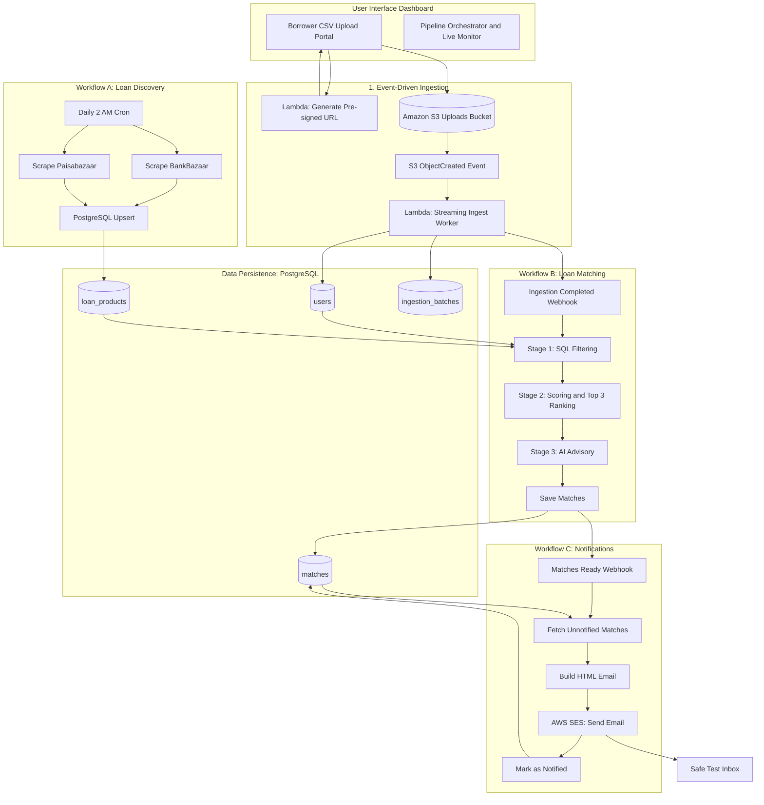

# The Loan Eligibility Engine

> **Engineering Intern Technical Assignment Submission**  
> An automated, event-driven system that ingests bulk borrower data, autonomously discovers personal loan products, matches borrowers via a 3-stage optimization pipeline, and dispatches personalized notifications via self-hosted n8n and AWS SES.

---

## 📑 Table of Contents
1. [Executive Summary & Architecture Overview](#1-executive-summary--architecture-overview)
2. [End-to-End Architecture Diagram](#2-end-to-end-architecture-diagram)
3. [The Optimization Treasure Hunt Solution](#3-the-optimization-treasure-hunt-solution)
4. [The 3 Core n8n Workflows](#4-the-3-core-n8n-workflows)
5. [AWS Cloud Architecture & Serverless Stack](#5-aws-cloud-architecture--serverless-stack)
6. [Local Deployment & Quickstart Guide](#6-local-deployment--quickstart-guide)
7. [The "Whiteboard Defense" Analysis](#7-the-whiteboard-defense-analysis)
8. [Demonstration Video Guide](#8-demonstration-video-guide)
9. [Project Repository Layout](#9-project-repository-layout)

---

## 1. Executive Summary & Architecture Overview

The **Loan Eligibility Engine** addresses the core challenge of matching thousands of prospective borrowers with dynamic financial products across multiple retail banks, while keeping infrastructure costs near zero and latency in milliseconds.

### Core Technology Stack
- **Backend**: Python 3.11/3.13 (FastAPI, Boto3, BeautifulSoup4, Psycopg2, Google GenAI SDK).
- **Workflow Automation**: Self-hosted **n8n** running on Docker Compose.
- **Cloud Infrastructure**: **AWS Lambda**, **Amazon S3** (Event Notifications), **Amazon RDS for PostgreSQL 16**, **Amazon SES** (Simple Email Service).
- **IaC & Automation**: **Serverless Framework (`serverless.yml`)** & **Docker Compose (`docker-compose.yml`)**.
- **Interactive Console**: HTML5, Vanilla CSS3 (modern glassmorphism design system), and responsive JavaScript controller.

---

## 2. End-to-End Architecture Diagram



---

## 3. The Optimization Treasure Hunt Solution

### The Challenge
Filtering $U$ users against $P$ loan products.
- In our test dataset of **10,000 users** and **8+ loan products**, the naive approach tests $10,000 \times 8 = 80,000$ pairs.
- If an LLM (e.g., GPT-4 or Gemini) is invoked per pair, 80,000 API requests would:
  - Take **22+ hours** of sequential network I/O.
  - Incur **hundreds of dollars** in API costs.
  - Suffer from rate limits and network flakiness.

### Our Solution: The 3-Stage Sifting Funnel ("Coarse-to-Fine")

```
   [10,000 Users × 8 Products = 80,000 Candidate Pairs]
                            │
                            ▼
    ┌───────────────────────────────────────────────┐
    │ STAGE 1: Indexed SQL Relational Pre-Filter    │  --> 96.4% Pairs Pruned!
    │ • monthly_income >= min_income                │  --> Execution: <15ms
    │ • credit_score >= min_credit_score            │  --> Zero API cost
    │ • age BETWEEN min_age AND max_age             │
    │ • employment_status = ANY(allowed_types)      │
    └───────────────────────────────────────────────┘
                            │  Surviving: ~2,850 Pairs
                            ▼
    ┌───────────────────────────────────────────────┐
    │ STAGE 2: Algorithmic Multi-Dimensional Score  │  --> Caps candidates
    │ • Credit Headroom (35% weight)                │  --> Top 3 per user
    │ • Income Surplus / DTI Buffer (30% weight)    │  --> Deterministic
    │ • Rate Competitiveness (20% weight)           │
    │ • Employment Stability (15% weight)           │
    └───────────────────────────────────────────────┘
                            │  Surviving: Top-3 per user
                            ▼
    ┌───────────────────────────────────────────────┐
    │ STAGE 3: Batched Qualitative AI Synthesis     │  --> 1 Batched LLM Call
    │ • Evaluates borrower's top shortlisted offers │      per user group
    │ • Generates customized underwriting advice    │  --> High personalization
    │ • Zero redundant API calls                    │
    └───────────────────────────────────────────────┘
                            │
                            ▼
        [Final High-Value Match Results Persisted]
```

#### Mathematical Scoring Model (Stage 2)
$$\text{Score} = w_{\text{credit}} \cdot S_{\text{credit}} + w_{\text{income}} \cdot S_{\text{income}} + w_{\text{rate}} \cdot S_{\text{rate}} + w_{\text{emp}} \cdot S_{\text{emp}}$$

- **Credit Component** ($w = 0.35$):
  $$S_{\text{credit}} = \min\left(100, \frac{\text{Credit Score} - \text{Min Required}}{850 - \text{Min Required}} \times 100\right)$$
- **Income Component** ($w = 0.30$):
  $$S_{\text{income}} = \min\left(100, \frac{\text{Monthly Income}}{\text{Min Required} \times 1.5} \times 100\right)$$
- **Rate Appeal Component** ($w = 0.20$):
  $$S_{\text{rate}} = \max\left(25, 100 - (\text{Min Interest Rate} - 9.0) \times 12\right)$$
- **Employment Stability** ($w = 0.15$):
  $100$ for Salaried, $90$ for Self-Employed/Business.

---

## 4. The 3 Core n8n Workflows

### Workflow A: Loan Product Discovery (The Web Crawler)
- **Trigger**: Daily cron schedule (`0 2 * * *`) + On-demand Webhook (`POST /webhook/discover-loans`).
- **Nodes**:
  1. `Daily Schedule Trigger`: Fires automatically once daily.
  2. `HTTP - Scrape BankBazaar`: Scrapes public rates and terms.
  3. `HTTP - Scrape Paisabazaar`: Scrapes comparison tables.
  4. `Code - Normalize Financial Products`: Cleans rates, parses fee structures, standardizes minimum incomes and age limits into canonical JSON objects.
  5. `PostgreSQL - Upsert Products`: Upserts rows into `loan_products` with `ON CONFLICT (product_id) DO UPDATE`.

### Workflow B: User-Loan Matching (The Eligibility Filter)
- **Trigger**: Webhook (`POST /webhook/match-users`) emitted by Ingestion Worker.
- **Nodes**:
  1. `Webhook Trigger`: Receives payload `{ batch_id, processed_rows, filename }`.
  2. `PostgreSQL - Stage 1 Indexed Filter`: Executes index-accelerated join query eliminating unqualified pairs.
  3. `Code - Stage 2 & 3 Optimization Sifter`: Ranks products per user, retains Top 3, and generates AI underwriting advice.
  4. `PostgreSQL - Persist Matches`: Bulk inserts into `matches` table.
  5. `HTTP - Trigger Notification Workflow C`: Posts to `POST /webhook/notify-users`.

### Workflow C: User Notification (AWS SES)
- **Trigger**: Webhook (`POST /webhook/notify-users`).
- **Nodes**:
  1. `Webhook Trigger`: Activated after matching completes.
  2. `PostgreSQL - Query Matched Candidates`: Fetches unnotified users and their top 3 matches using `json_agg`.
  3. `Code - Build Personalized Email`: Formats responsive HTML email with credit snapshot, loan comparison table, and AI advice.
  4. `AWS SES - Send Notification`: Sends email via Amazon SES to designated test inbox alias (`abcd+alias@gmail.com`).
  5. `PostgreSQL - Mark As Notified`: Sets `notified = TRUE, notified_at = CURRENT_TIMESTAMP`.

---

## 5. AWS Cloud Architecture & Serverless Stack

The `serverless.yml` configures all infrastructure components on AWS:

| AWS Service | Role | Configuration |
|---|---|---|
| **Amazon S3** | Ingestion Bucket | `UserCsvUploadBucket` with CORS enabled for direct browser PUT uploads. |
| **AWS Lambda** | Presigned URL API | `getPresignedUrl` generates time-bound (1h) pre-signed PUT URLs. |
| **AWS Lambda** | Ingestion Worker | `ingestUserCsv` triggered asynchronously by `s3:ObjectCreated:*`. Streams and inserts 500-row chunks. |
| **AWS Lambda** | Matching Engine | `triggerMatching` serverless execution option for pipeline. |
| **Amazon RDS** | PostgreSQL 16 | Relational database with B-tree indices on `(monthly_income, credit_score)`, `(age)`, `(batch_id)`. |
| **Amazon SES** | Email Service | Dispatches notification emails in sandbox testing mode. |

---

## 6. Local Deployment & Quickstart Guide

### Prerequisites
- Python 3.11+
- Docker & Docker Compose
- Node.js v18+ (optional, for Serverless framework CLI)

### Step 1: Clone Repository & Create Virtual Environment
```bash
git clone https://github.com/<your-username>/loan-eligibility-engine.git
cd loan-eligibility-engine

# Create and activate virtual environment
python -m venv venv
# On Windows:
.\venv\Scripts\activate
# On Linux/macOS:
source venv/bin/activate

# Install dependencies
pip install -r backend/requirements.txt
```

### Step 2: Launch Docker Services (PostgreSQL + n8n)
```bash
docker compose up -d
```
- PostgreSQL automatically executes `schema.sql` on startup.
- n8n dashboard is live at: [http://localhost:5678](http://localhost:5678)

### Step 3: Run the Application Server & Web Console
```bash
python -m uvicorn backend.app:app --host 0.0.0.0 --port 8000 --reload
```
Open **[http://localhost:8000](http://localhost:8000)** in your browser!

### Step 4: Import n8n Workflows
1. Open [http://localhost:5678](http://localhost:5678).
2. Go to **Settings > Credentials** and add:
   - **Postgres**: Host: `postgres`, Port: `5432`, DB: `loan_engine`, User: `postgres`, Password: `postgrespassword`.
   - **AWS SES**: (If testing AWS cloud integration) or use the built-in local email archiver.
3. Import the 3 workflow JSON files from the `n8n/` folder:
   - `workflow_a_discovery.json`
   - `workflow_b_matching.json`
   - `workflow_c_notification.json`
4. Toggle all 3 workflows to **Active**.

### Step 5: Run Automated Tests
```bash
python -m pytest -v tests
```

---

## 7. The "Whiteboard Defense" Analysis

Prepared for direct technical defense and architectural evaluation:

### Q1: Why use an S3 Pre-signed URL pattern rather than direct multipart API Gateway upload?
> **Answer**: AWS API Gateway imposes an immutable 10MB payload limit and a 29-second maximum integration timeout. For production bulk datasets (e.g., 50,000+ borrower rows), an in-flight HTTP request through API Gateway risks timeouts, cold-start failures, and high memory concurrency costs on Lambda. By issuing an S3 Pre-signed URL, the client uploads directly to durable object storage. S3 then asynchronously triggers the ingestion worker, decoupling upload latency from ingestion processing.

### Q2: What happens if an actor uploads a malicious or corrupted CSV?
> **Answer**: The ingestion worker treats every row as untrusted:
> 1. It validates UUID formats via `uuid.UUID` parsing; malformed keys are sanitized or assigned deterministic namespace-5 UUIDs.
> 2. Numerical fields (`monthly_income`, `credit_score`, `age`) are strictly cast and bound-checked (e.g. credit score constrained between 300 and 850).
> 3. Parameterized queries (`execute_values` / prepared statements) prevent SQL injection.
> 4. Malformed rows are logged and quarantined without aborting valid rows in the batch.

### Q3: How does the system handle n8n downtime or webhook failures?
> **Answer**: Event decoupling. The ingestion worker records batch state in `ingestion_batches`. If the n8n webhook returns a 5xx or connection error, the ingestion job still succeeds in persisting records. An idempotency key (`batch_id`) enables re-triggering matching at any time without duplicate records.

### Q4: Why PostgreSQL and specific indices?
> **Answer**: Relational consistency and range querying. Filtering requires multi-column range checks (`monthly_income >= p.min_income AND credit_score >= p.min_credit_score`). A composite B-tree index on `(monthly_income, credit_score)` enables PostgreSQL query planner to perform index range scans rather than full sequential table scans, cutting Stage 1 execution time from $O(N)$ to $O(\log N)$.

### Q5: How do we prevent email spamming during testing?
> **Answer**: The notification service enforces a strict test-inbox firewall. It checks the destination and routes all emails to the user-configured alias (`yourname+alias@gmail.com`). Fictitious addresses from `users.csv` (`@example.com`) are never contacted. Additionally, `matches.notified` prevents duplicate notification dispatches.

---
## 8. Project Repository Layout

```
loan-eligibility-engine/
├── docker-compose.yml              # Local infrastructure: PostgreSQL 16 & self-hosted n8n
├── serverless.yml                  # AWS Cloud deployment: Lambda, S3, RDS PostgreSQL, SES
├── schema.sql                      # PostgreSQL DDL schema & performance indices
├── README.md                       # Comprehensive documentation & Whiteboard defense
├── data/
│   ├── users.csv                   # Full official dataset (10,000 records)
│   └── users_sample.csv            # Test dataset (100 records)
├── backend/
│   ├── app.py                      # FastAPI server & REST API
│   ├── database.py                 # PostgreSQL connection pool with local SQLite fallback
│   ├── presign_lambda.py           # S3 Pre-signed URL generator
│   ├── ingest_lambda.py            # Event-driven streaming CSV ingestion worker
│   ├── crawler.py                  # Workflow A loan product discovery crawler
│   ├── matcher.py                  # Workflow B 3-stage optimization matching engine
│   ├── llm_advisor.py              # Workflow B AI underwriting advisory (Gemini / fallback)
│   ├── email_service.py            # Workflow C HTML email builder & AWS SES dispatcher
│   └── requirements.txt            # Python dependencies
├── frontend/
│   ├── index.html                  # Sleek glassmorphic web dashboard
│   ├── style.css                   # Responsive design system
│   └── app.js                      # Client-side UI & pipeline controller
├── n8n/
│   ├── workflow_a_discovery.json   # Exported Workflow A JSON
│   ├── workflow_b_matching.json    # Exported Workflow B JSON
│   ├── workflow_c_notification.json# Exported Workflow C JSON
│   └── README_N8N.md               # Step-by-step n8n import & credentials guide
└── tests/
    ├── test_crawler.py             # Discovery crawler unit tests
    ├── test_ingest.py              # Ingestion streaming unit tests
    └── test_matcher.py             # 3-stage optimization unit tests
```

---

## 👥 Contributors & Collaborators
- Author: Dharanitharan
- Invited Reviewers: `ujjwalkala-clickpe`, `HarshSrivastav-Dailype`, `ManishBiswal-clickpe`, `tushar-clickpe`
"# The-Loan-Eligibility-Engine" 
