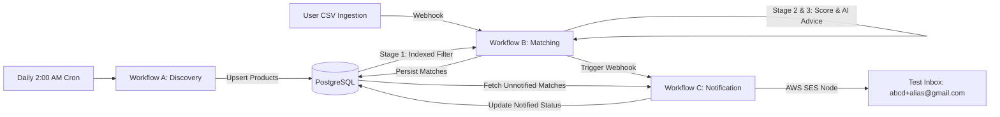

# n8n Workflow Automation Engine Guide

This folder contains the complete, production-ready export JSON files for all three required n8n workflows:

1. **Workflow A (`workflow_a_discovery.json`)**: Autonomous Loan Product Discovery & Web Crawler.
2. **Workflow B (`workflow_b_matching.json`)**: Multi-Stage User-Loan Matching & Optimization Funnel.
3. **Workflow C (`workflow_c_notification.json`)**: User Notification Engine with AWS SES & Safe Test Inbox Routing.

---

## 1. Quick Launch with Docker Compose

Launch the self-hosted n8n instance and PostgreSQL database with one command:

```bash
docker compose up -d
```

- **n8n Web UI**: [http://localhost:5678](http://localhost:5678)
- **PostgreSQL**: `localhost:5432` (Database: `loan_engine`, User: `postgres`, Password: `postgrespassword`)

---

## 2. Configuring Credentials in n8n

Before executing the workflows, configure the credentials in the n8n UI under **Settings > Credentials**:

### A. PostgreSQL Credential (`Postgres Loan Engine`)
Used by all 3 workflows to query and persist users, products, and matches.

| Field | Value |
|---|---|
| **Credential Name** | `Postgres Loan Engine` |
| **Host** | `postgres` (or `localhost` if running outside Docker network) |
| **Database** | `loan_engine` |
| **User** | `postgres` |
| **Password** | `postgrespassword` |
| **Port** | `5432` |
| **SSL** | `disable` (for local Docker) or `require` (for AWS RDS) |

### B. AWS SES Credential (`AWS SES Credentials`)
Used by Workflow C to send verified email notifications.

| Field | Value |
|---|---|
| **Credential Name** | `AWS SES Credentials` |
| **Region** | `ap-south-1` (Mumbai) or your AWS region |
| **Access Key ID** | Your IAM User Access Key |
| **Secret Access Key** | Your IAM User Secret Key |

*(Note: In local or sandbox mode, emails are also saved to `data/sent_emails/*.html` for instant preview without requiring an active AWS bill).*

---

## 3. Importing the Workflows into n8n

1. Open [http://localhost:5678](http://localhost:5678).
2. Click **Add Workflow** > Click the top-right **`...`** menu > **Import from File**.
3. Select and import:
   - `workflow_a_discovery.json`
   - `workflow_b_matching.json`
   - `workflow_c_notification.json`
4. Assign the credentials created in Step 2 to the respective PostgreSQL and AWS SES nodes.
5. Click **Save** and toggle each workflow to **Active**.

---

## 4. End-to-End Interconnection Flow



### Webhook Endpoints
- **Workflow A (Manual Discovery)**: `POST http://localhost:5678/webhook/discover-loans`
- **Workflow B (Matching Trigger)**: `POST http://localhost:5678/webhook/match-users`
- **Workflow C (Notification Trigger)**: `POST http://localhost:5678/webhook/notify-users`
